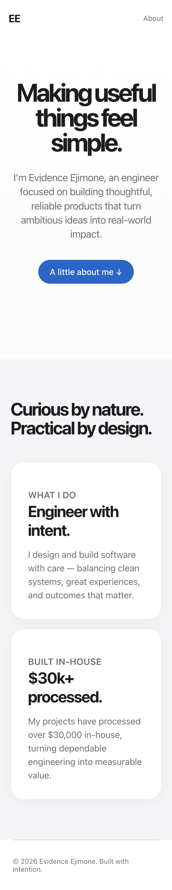
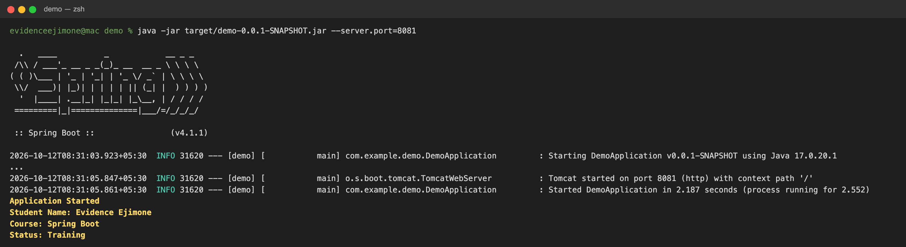

# Evidence Ejimone 

## Homepage



## Startup output (CommandLineRunner)

When the application starts, `StudentInfoRunner` (a `CommandLineRunner`) prints the student details to the console:

```
Application Started
Student Name: Evidence Ejimone
Course: Spring Boot
Status: Training
```



## Run locally

```bash
mvn spring-boot:run
```

Then open [http://localhost:8080](http://localhost:8080).

## Tech stack

- Java 17+
- Spring Boot
- HTML and CSS
